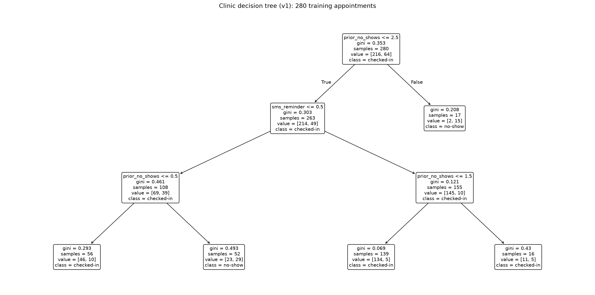
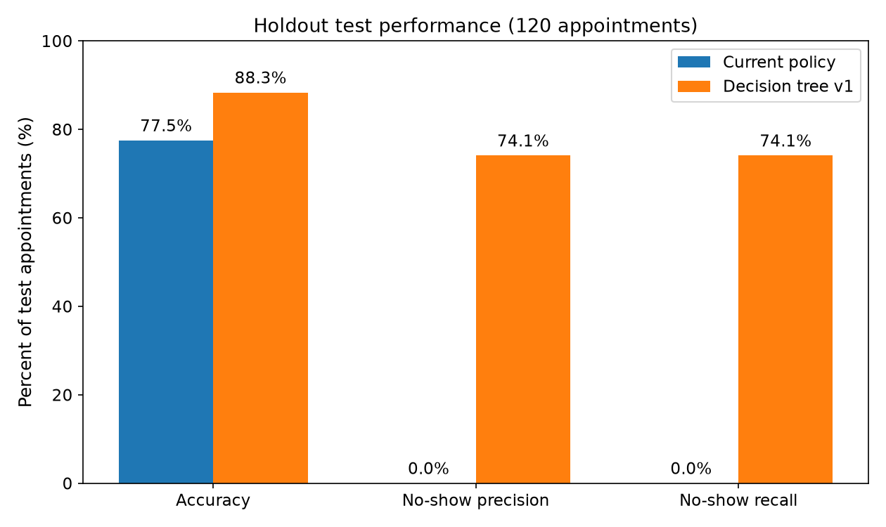
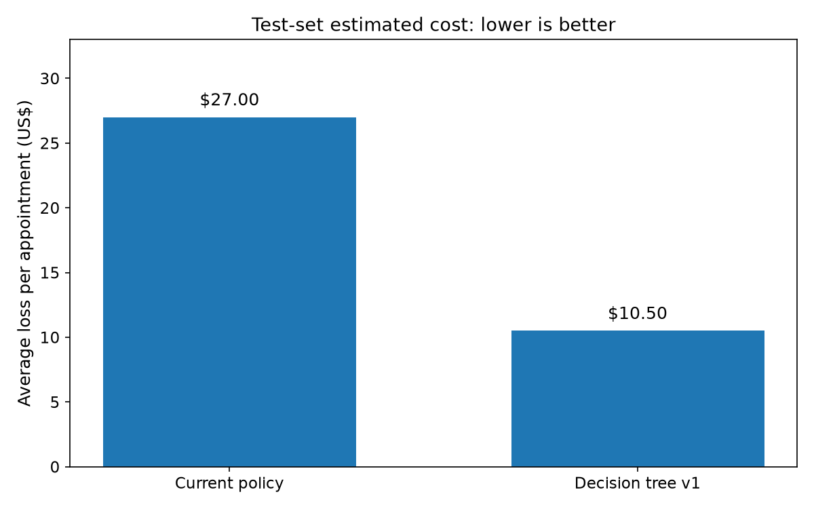

# Clinic no-show decision tree (v1)

On the 120-appointment holdout, decision tree v1 lowers average loss from **$27.00** per appointment under the current policy to **$10.50**. Accuracy moves from **77.5%** to **88.3%**. The tree recovers **74.1%** of no-shows, and **74.1%** of the visits it flags are no-shows. The current policy flags none.

The flag is a scheduling aid: a reminder call, or a cautious overbook. It is not a reason to cancel the visit.

## Data

`clinic_appointments.csv` has 400 appointments.

| Split | appointment_id | Rows | Checked-in | No-show |
|---|---:|---:|---:|---:|
| Training | 1–280 | 280 | 216 | 64 |
| Holdout | 281–400 | 120 | 93 | 27 |

Training no-show rate: 22.9%. Holdout no-show rate: 22.5%.

v1 is fit on `prior_no_shows` and `sms_reminder` only.

| Column | Role in v1 |
|---|---|
| appointment_id | Row id. 1–280 train, 281–400 holdout. |
| prior_no_shows | Model input. Earlier missed visits. Values in this file are 0, 1, 2, or 3. |
| sms_reminder | Model input. 1 means an SMS reminder was sent, 0 means it was not. |
| outcome | Target. `checked-in` or `no-show`. |
| age | Not used. Age in years. |
| lead_time_days | Not used. Days from booking to the visit. |
| weekday | Not used. Clinic day, Monday–Friday. |

This is a 400-row teaching file built so the script redraws the v1 tree and the holdout charts. It does not contain real patient records.

### Training counts

| Prior no-shows | No SMS, checked-in | No SMS, no-show | SMS, checked-in | SMS, no-show |
|---:|---:|---:|---:|---:|
| 0 | 46 | 10 | 98 | 3 |
| 1 | 17 | 21 | 36 | 2 |
| 2 | 6 | 8 | 11 | 5 |
| 3 | 0 | 0 | 2 | 15 |

All 17 training patients with 3 prior no-shows have `sms_reminder` = 1, so the top-right leaf has no reminder split to learn.

### Holdout counts

| Prior no-shows | No SMS, checked-in | No SMS, no-show | SMS, checked-in | SMS, no-show |
|---:|---:|---:|---:|---:|
| 0 | 18 | 4 | 49 | 1 |
| 1 | 4 | 5 | 13 | 1 |
| 2 | 1 | 5 | 6 | 1 |
| 3 | 1 | 4 | 1 | 6 |

## The tree

Gini impurity is the split score. It is 0 when a node has one outcome and higher when the two outcomes are mixed. In each box, `value = [checked-in, no-show]` and `class` is the larger of those two counts.



Read the boxes as this rule.

Predict **no-show** when either line is true:

- `prior_no_shows` is 3 or more (in this file, 3). On the root's false branch, 15 of 17 training patients missed
- no SMS was sent, and `prior_no_shows` is 1 or 2 (29 of 52 training patients missed)

Predict **checked-in** for everyone else:

- `prior_no_shows` is 0, whether or not an SMS went out
- an SMS was sent and `prior_no_shows` is 1 or 2

The SMS branch splits once more, at 2 prior no-shows, because that group is more mixed (gini 0.43 versus 0.069). Both of those leaves still have a checked-in majority, so the extra split does not create a no-show flag. Under v1, a patient who received an SMS is flagged only when they already have 3 prior no-shows.

| Leaf | Training patients | Checked-in | No-show | Gini | Prediction |
|---|---:|---:|---:|---:|---|
| 3 prior no-shows | 17 | 2 | 15 | 0.208 | no-show |
| No SMS, 0 prior no-shows | 56 | 46 | 10 | 0.293 | checked-in |
| No SMS, 1 or 2 prior no-shows | 52 | 23 | 29 | 0.493 | no-show |
| SMS, 0 or 1 prior no-shows | 139 | 134 | 5 | 0.069 | checked-in |
| SMS, 2 prior no-shows | 16 | 11 | 5 | 0.43 | checked-in |

The same rule in text form:

```
|--- prior_no_shows <= 2.5
|   |--- sms_reminder <= 0.5
|   |   |--- prior_no_shows <= 0.5
|   |   |   |--- class: checked-in
|   |   |--- prior_no_shows >  0.5
|   |   |   |--- class: no-show
|   |--- sms_reminder >  0.5
|   |   |--- prior_no_shows <= 1.5
|   |   |   |--- class: checked-in
|   |   |--- prior_no_shows >  1.5
|   |   |   |--- class: checked-in
|--- prior_no_shows >  2.5
|   |--- class: no-show
```

`DecisionTreeClassifier(max_depth=3)` is what keeps the drawing at five leaves. Fitting the same two columns with no depth cap splits the "no SMS, 1 or 2 prior" leaf into prior = 1 and prior = 2, and splits the "SMS, 0 or 1 prior" leaf into prior = 0 and prior = 1. In this training set each of those child pairs shares a majority class. Predicted labels on the training rows and on the holdout match the unrestricted tree, so the depth cap changes the drawing and leaves the flags alone.

## Holdout performance

The current policy predicts `checked-in` for every appointment. It is right on the 93 patients who arrive, which is 77.5% of the holdout, and it misses all 27 no-shows. With zero no-show flags, no-show precision and recall are both 0.

The tree flags 27 holdout appointments. There are also 27 actual no-shows. Those two sets share 20 appointments, so precision and recall are the same ratio, 20/27 = 74.1%. The other 14 calls are split evenly: 7 false alarms and 7 missed no-shows. Correct calls: 20 + 86 = 106, which is 88.3%.

|  | Predicted checked-in | Predicted no-show |
|---|---:|---:|
| Actual checked-in | 86 | 7 |
| Actual no-show | 7 | 20 |

| Metric | Current policy | Decision tree v1 |
|---|---:|---:|
| Accuracy | 77.5% | 88.3% |
| No-show precision | 0.0% | 74.1% |
| No-show recall | 0.0% | 74.1% |



## Estimated cost

Loss is charged only on a wrong call.

| Call | Loss |
|---|---:|
| Predict checked-in, patient no-shows (empty slot) | $120 |
| Predict no-show, patient checks in (false alarm) | $60 |
| Correct call | $0 |

Current policy: 27 missed no-shows and 0 false alarms.

- Total: 27 × $120 = $3,240.00
- Average: $3,240.00 / 120 = **$27.00**

Decision tree v1: 7 missed no-shows and 7 false alarms.

- Missed no-shows: 7 × $120 = $840.00
- False alarms: 7 × $60 = $420.00
- Total: $1,260.00
- Average: $1,260.00 / 120 = **$10.50**

The holdout difference is $16.50 per appointment, or $1,980.00 across the 120 visits.



## Limits

- The holdout is the 120 rows with `appointment_id` above 280. The script does not draw a new random split; a new split would not reproduce these node counts.
- The published averages use the $120 / $60 loss above. A different price for an empty slot or a false alarm moves both bars.
- Age, lead time, and weekday stay out of v1. Adding them fits a different tree.
- Training never shows a patient with 3 prior no-shows and no SMS, so that leaf does not measure the reminder. The holdout does include both reminder values at 3 prior no-shows, and the fitted rule flags both.
- These rows are a teaching file, not a live clinic extract, and the tree is not a clinical decision system.
